# ASTRA: Autonomous Spaceflight Telemetry, Risk Analytics & Emergency Response

[](#offline-first-capability)
[](#cybersecurity-and-audit)
[](#nasa-research-data-integration)
[-purple.svg)](#progressive-web-app)

> [!NOTE]
> **Prototype & Research Disclaimer**: ASTRA is a research and hackathon prototype designed to demonstrate how future astronaut healthcare systems could operate independently during communication blackouts on long-duration exploration missions (such as Artemis Lunar base or Mars Transit). It is **not flight-certified**, **not clinically validated**, and **does not access private NASA astronaut medical records**.

---

## 1. System Architecture

ASTRA features a modular, layered architecture designed to remain fully functional without internet access:

```mermaid
flowchart TD
    subgraph SENSORS ["1. Hardware & Sensor Layer (Modular Adapters)"]
        S1["MAX30102 (SpO2 / Pulse Rate)"]
        S2["AD8232 (Lead II ECG Analog Front-End)"]
        S3["BME680 (Pressure, Temp, Humidity, VOC)"]
        S4["ESP32-S3 Biomedical Gateway (USB/BLE)"]
        S5["Synthetic Telemetry Generator"]
    end

    subgraph GATEWAY ["2. Gateway & Signal Validation Layer"]
        G1["Serial/USB / BLE Ingestion"]
        G2["Signal Quality Index (SQI) Filter"]
        G3["Outlier & Motion Artifact Rejection"]
        G4["Provenance Tagging: LIVE / NASA_RES / SIM"]
    end

    subgraph ONBOARD ["3. Onboard Health & AI Engine (Offline Core)"]
        AI1["Personal Baseline Calibration (Z-Score/Rolling)"]
        AI2["Multivariate Anomaly Detection"]
        AI3["Sensor Fusion & Correlation Engine"]
        AI4["Predictive Risk Horizons (1h / 6h / 24h)"]
        AI5["Explainable AI (XAI) Attribution"]
        AI6["Deterministic Rule-Based Fallback"]
    end

    subgraph EMERGENCY ["4. Autonomous Emergency Response"]
        E1["Severity Triage: INFO / WARN / CRIT / SENSOR / COMM"]
        E2["Interactive Offline Clinical Checklists"]
        E3["Tamper-Evident Incident Timeline"]
        E4["Medical Formulary & Depletion Prediction"]
    end

    subgraph STORAGE ["5. Offline-First Storage & Synchronization"]
        DB1["Local SQLite in WAL Mode (Onboard Host)"]
        DB2["Browser IndexedDB & Service Worker (PWA)"]
        SYNC["Store-and-Forward Sync Queue (AES-256-GCM)"]
    end

    subgraph UI ["6. Aerospace Operations HUD"]
        UI1["60 FPS Canvas Oscilloscope (ECG Lead II)"]
        UI2["Multi-Astronaut Matrix Monitoring"]
        UI3["NASA OSDR Research Explorer"]
        UI4["Digital Health Twin Longitudinal Analytics"]
        UI5["Psychomotor Vigilance Task (PVT Interactive)"]
        UI6["Role-Based Access Control (RBAC) Console"]
    end

    SENSORS --> GATEWAY
    GATEWAY --> ONBOARD
    ONBOARD --> EMERGENCY
    ONBOARD --> STORAGE
    EMERGENCY --> STORAGE
    STORAGE --> UI
    ONBOARD --> UI
```



    The ground-staff default view is a crew-wide monitoring dashboard with current telemetry, system-generated flags, signal quality, and shared cabin conditions. It links to each astronaut's detailed vitals view and labels standalone readings as simulated. The dashboard is an informational prototype, not a clinically validated or flight-certified medical system.

    ---

## 2. Offline Capability (Prototype Status)

The application has local components, but does not yet provide complete autonomous offline operation:
- **Progressive Web App (PWA)**: A manifest and service-worker file exist, but service-worker registration and asset paths are not currently reliable in the decoupled frontend. Do not rely on the browser interface being cached for blackout operation.
- **Local SQLite Engine**: Configured in Write-Ahead Logging (`PRAGMA journal_mode = WAL`) and `PRAGMA synchronous = NORMAL` for high write throughput and crash resistance.
- **IndexedDB Client Cache**: Not implemented as a durable offline health-record store.
- **Store-and-Forward Queue**: Events are timestamped with ISO 8601 UTC, assigned cryptographic UUIDs, and prioritized:
  1. `Priority 1`: Critical emergency declarations and acute interventions.
  2. `Priority 2`: Sub-critical warnings and medication depletion notifications.
  3. `Priority 3`: Routine biometric telemetry and baseline recalculations.
- **Connection States**:
  - `ONLINE`: Prototype connectivity state; not a real DSN link.
  - `OFFLINE`: Queueing mode in the local backend, not proof of end-to-end autonomous operation.
  - `SYNCING`: Active store-and-forward batch transmission with conflict reconciliation.

---

## 3. Advanced Physiological Telemetry

For every monitored parameter, ASTRA tracks:
- Current reading and standard unit
- High-precision timestamp (ISO 8601 UTC)
- Data Quality Index (SQI 0–100%)
- Calibrated personal baseline and Z-score deviation
- **Strict Provenance Label**:
  - `LIVE_SENSOR_DATA` (Physical hardware sensor stream)
  - `NASA_RESEARCH_DATA` (NASA OSDR open science datasets)
  - `SIMULATED_PROTOTYPE_DATA` (High-fidelity synthetic flight scenarios)

### Supported Parameters
| Category | Measurements |
| :--- | :--- |
| **Cardiovascular** | Heart Rate (BPM), Heart Rate Variability (SDNN/RMSSD ms), Continuous Lead II ECG Waveform (mV), Rolling 60s BPM Trend Graph, Blood Pressure (Systolic/Diastolic mmHg), Pulse Pressure, Mean Arterial Pressure (MAP), Cardiac Output (L/min), Stroke Volume (mL), Systemic Vascular Resistance (SVR) |
| **Respiratory** | Peripheral Oxygen Saturation (SpO2 %), Respiratory Rate (breaths/min), End-Tidal CO2 (EtCO2 mmHg), Breathing Pattern Regularity |
| **Neuro-Ocular & SANS** | Optic Nerve Sheath Diameter (ONSD mm), Estimated Intracranial Pressure (ICP mmHg), Cephalad Venous Fluid Shift (mL), Frisén Papilledema Grade |
| **Ground Operations** | Ground Scientist Directives, Chief Surgeon Medical Clearance Sign-offs, DSN Two-Way Messaging Transceiver, Light-Time Delay Simulator (LEO / Lunar / Mars) |
| **Metabolic & Body** | Core Body Temperature (°C/°F), Hydration Status, Daily Activity Index (g), Aerobic/Resistive ARED Compliance, Estimated VO2 Max (%) |
| **Spaceflight Environment** | Cabin Total Pressure (kPa), ppO2 (%), ppCO2 (mmHg), Cabin Temperature (°C), Relative Humidity (%), Radiation Flux (µSv/h) |
| **Cognitive** | Psychomotor Vigilance Task (PVT) Reaction Time (ms), Attentional Lapses (>500 ms), Subjective Fatigue Level |

### Astronaut Health Timeline
The **Body** view plots the latest stored HR, SpO2, respiratory-rate, or systolic-pressure samples against the crew profile's configured reference baseline. It shows sample count, actual non-empty field completeness, timestamps, and source categories. The backend stores simulated demonstration snapshots no more than once every 30 seconds; they are labeled `SIMULATED_PROTOTYPE_DATA`. Physical sensor packets are stored on ingestion. If no backend records exist, the view reports no history instead of inventing a trend. This is a measurement history, not a fully simulated biological twin or clinical assessment.

---

## 4. Hardware Integration & Low-Cost Bill of Materials (BOM)

ASTRA demonstrates that advanced aerospace healthcare technology can be prototyped using accessible, low-power open hardware:

| Component | Qty | Unit Cost (USD) | Total Cost (USD) | Classification & Purpose |
| :--- | :---: | :---: | :---: | :--- |
| **ESP32-S3 Dual-Core Node** | 4 | $7.50 | $30.00 | Prototype wireless/USB telemetry acquisition gateway |
| **MAX30102 Pulse Oximeter** | 4 | $4.80 | $19.20 | Prototype SpO2 and PPG pulse transit sampling |
| **AD8232 ECG Front-End** | 4 | $6.20 | $24.80 | Lead II biopotential acquisition & vector analysis |
| **BME680 Sensor Module** | 2 | $14.50 | $29.00 | Spacecraft cabin environmental MEMS (CO2/VOC/Pressure) |
| **Single-Board Computer (COTS)** | 1 | $80.00 | $80.00 | Onboard local server, SQLite host, and AI inference |
| **Leads, Batteries & Casing** | 1 | $35.00 | $35.00 | Power management, biomedical leads, and enclosures |
| **TOTAL ESTIMATED BOM** | — | — | **$218.00** | *Complete autonomous crew health monitoring suite* |

> [!WARNING]
> Consumer-grade sensors (MAX30102, AD8232) are experimental prototypes and are **not medically certified** or qualified for human spaceflight missions.

---

## 5. Explainable AI (XAI) & Anomaly Detection

ASTRA rejects "black-box" predictions. When an anomaly is identified, the **Explainable AI (XAI)** drawer details:
1. **What changed?** Explicit delta from baseline (e.g., HR +70 bpm above resting).
2. **Which metrics contributed?** Multivariate correlation (e.g., HR high + motion low = inappropriate tachycardia).
3. **What baseline was used?** Astronaut's individual historical resting values.
4. **Persistence duration & SQI**: Signal Quality Index confirmation (distinguishing true pathology from motion artifacts).
5. **Approved Procedure**: Direct one-click link to the approved clinical checklist.

---

## Incident Response Console

The **Tasks** view now displays unresolved backend incidents, their astronaut/severity/timestamp/notes, acknowledgement state, linked checklist progress, and explicit step completion actions. Incident closure asks for a review note and confirmation. Each action is written through the local emergency API and audit logging.

This remains a demonstration interface: the application does not authenticate users or enforce backend roles, so the console is not an authorization boundary and must not be used for real medical response. Checklist text also requires approval by the responsible mission medical authority.

---

## 6. NASA Open Science Data Repository (OSDR) Integration

ASTRA connects to the public **NASA OSDR** API:
- Search API: `https://osdr.nasa.gov/osdr/data/search`
- Metadata API: `https://osdr.nasa.gov/osdr/data/osd/meta/{id}`
- Files API: `https://osdr.nasa.gov/osdr/data/osd/files/{id}`

### Scientist Research Workbench
The scientist workbench searches NASA OSDR, displays study metadata and per-file access status, and can download listed public files through the local backend. Downloads are preserved as received, subject to a 100 MiB prototype limit, and recorded with a SHA-256 checksum, source URL, import time, and dataset version. Search and curated study summaries are available offline; uncached metadata and file downloads require connectivity.

The curated offline catalogue is limited to four records and is not a cache of full dataset files:
- **OSD-379**: Mouse liver transcription research from RRRM-1; not the NASA Twins Study.
- **OSD-542**: Human 14-day ground confinement study; not astronaut flight telemetry.
- **OSD-137**: Rodent Research-3 mouse research.
- **OSD-254**: Rodent Research-7 mouse dorsal-skin transcription research.

Every study requires population, study-design, measurement, units, timeline, and access review before scientific use. Historical datasets are never imported into astronaut health records or presented as current telemetry. Dataset preview, data-dictionary parsing, analysis, and cohort comparison are not implemented.

---

## 7. Cybersecurity and Audit

- **Role-Based Access Control (RBAC)**:
  - Role names and permission declarations exist for `ASTRONAUT`, `FLIGHT_SURGEON`, `MISSION_CONTROL`, `MEDICAL_ADMIN`, and `SYSTEM_ADMIN`.
  - **Backend authentication and route-level role enforcement are not implemented.** The role selector is a UI/demo control, not an access-control boundary.
- **AES-256-GCM Encryption**: Store-and-forward queue payloads use authenticated 256-bit AES-GCM. This does not mean all database medical records are encrypted at rest; the prototype key is stored locally and is not hardware-backed.
- **Tamper-Evident SHA-256 Hash Chaining**: Every system action is chained cryptographically to the preceding record:
  $$\text{Hash}_n = \text{SHA-256}(\text{Hash}_{n-1} \parallel \text{Timestamp} \parallel \text{User} \parallel \text{Role} \parallel \text{Action} \parallel \text{Details})$$

---

## 8. Quick Start & Execution (Decoupled Architecture)

ASTRA separates the frontend client from the backend REST API:
- **Frontend Client**: Pure static web application (`frontend/index.html`) running on port `3000` (or opened directly). Operates standalone with built-in telemetry simulation or connects seamlessly to the backend.
- **Backend REST API**: Request-driven FastAPI microservice on port `8000` (`http://localhost:8000/docs`). Zero unmanaged background threads or continuous background loops.

### Conversational Health Assistant

The AstroAI chat uses Groq's chat-completions API from the backend. Configure the key in a local `.env` file at the project root (next to `run_backend.ps1`), never in frontend code:

1. Copy `.env.example` to `.env`.
2. Open `.env` and replace `add_your_groq_api_key_here` with your key from the Groq console:

   ```dotenv
   GROQ_API_KEY=your-groq-api-key
   GROQ_MODEL=llama-3.3-70b-versatile
   ```

3. Save the file and restart the backend (`.\run_backend.ps1`) or relaunch the full app (`.\run_astra.ps1`).
4. Confirm configuration at `http://127.0.0.1:8000/api/assistant/status`; `configured` should be `true`.

The local `.env` file is ignored by Git. Environment variables already set for the backend process take precedence over values in `.env`. Never share or commit your key.
If chat reports `Cloudflare 1010`, the key is present but Groq's network edge blocked the request; check your Groq account/network access or contact Groq support.

Chat prompts are sent to Groq. Do not enter astronaut names, identifying details, or private/patient-level health information. The app does not attach telemetry, astronaut records, or other app data to chat requests, and the chat endpoint accepts local clients only. Conversation history stays in the browser's memory and is cleared when the page is reloaded. AstroAI provides general educational information only; it is not clinically validated and cannot diagnose or replace a flight surgeon.

### Option A: Launch Both Services Simultaneously
```cmd
run_astra.bat
```
*(Or PowerShell: `.\run_astra.ps1`)*

### Option B: Launch Decoupled Services Independently

1. **Start Backend REST API (Port 8000)**:
   ```cmd
   run_backend.bat
   ```
   *Powershell:* `.\run_backend.ps1`
   *Docs available at:* `http://localhost:8000/docs`

2. **Start Frontend Web Client (Port 3000)**:
   ```cmd
   run_frontend.bat
   ```
   *Powershell:* `.\run_frontend.ps1`
   *Web application opens at:* `http://localhost:3000`

---

## 9. Hackathon Demonstration Guide

Follow these steps for an end-to-end demonstration:
1. **Mission Overview & Live Oscilloscope**:
   - Open `http://localhost:8000`.
   - Observe the 2 monitored astronauts, the ground staff roster, and the active **60 FPS Canvas Lead II ECG Oscilloscope** with phosphor sweep.
2. **Interactive Psychomotor Vigilance Task (PVT)**:
   - Navigate to **Mental Wellbeing (PVT)** in the sidebar.
   - Click the stimulus screen to initiate a cognitive reaction time test.
   - Observe the millisecond reaction timer and automatic logging to ASTRA.
3. **Clinical Emergency Simulation**:
   - Select **CDR Alex Mercer** in the bottom control bar.
   - Choose `EVA Inappropriate Tachycardia (140+ bpm)` and click **Apply Scenario**.
   - Observe the immediate red HUD alert banner and **AI Health Intelligence** notification.
   - Click **Execute Medical Checklist** to open the offline clinical procedure `PROC-CARD-02`.
   - Check off steps interactively; click **Resolve Incident**.
4. **ECLSS Spacecraft Environmental Drill**:
   - Navigate to **Cabin Environment**.
   - Click **Inject CO2 Scrubber Failure (6.5 mmHg)**.
   - Observe how the AI engine correlates the astronaut's vitals with cabin atmospheric contamination.
5. **NASA OSDR Research Workbench**:
   - Navigate to **NASA Research Explorer**.
   - Search for `rodent` or select a research category.
   - Review population, measurement type, study design, validation checks, and file access. OSD-379 is mouse research and OSD-542 is a ground-confinement analog, not current astronaut telemetry.
   - When online, inspect dataset files; only listed, visible, unrestricted files can be downloaded by the local backend. Verify the returned file path and SHA-256 checksum.
6. **Store-and-Forward Synchronization Drill**:
   - Navigate to **Store & Forward Sync**.
   - Observe the queue in `OFFLINE` mode.
   - Click **Connect DSN Link (ONLINE)** and click **Flush Sync Batch Now** to observe encrypted packet reconciliation.
7. **Cybersecurity & Audit Verification**:
   - Navigate to **Cybersecurity & Audit**.
   - Inspect the live SHA-256 hash chain and confirm the green `CRYPTO CHAIN INTACT` status.
8. **Affordable Hardware Bill of Materials (BOM)**:
   - Navigate to **Diagnostics & Cost BOM** to present the comprehensive open-hardware breakdown ($218 total system cost).
